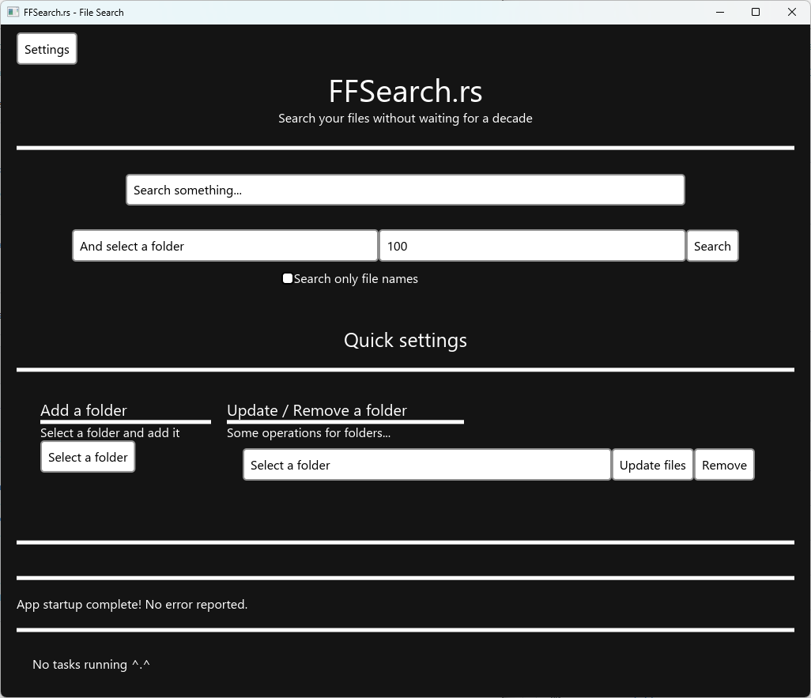
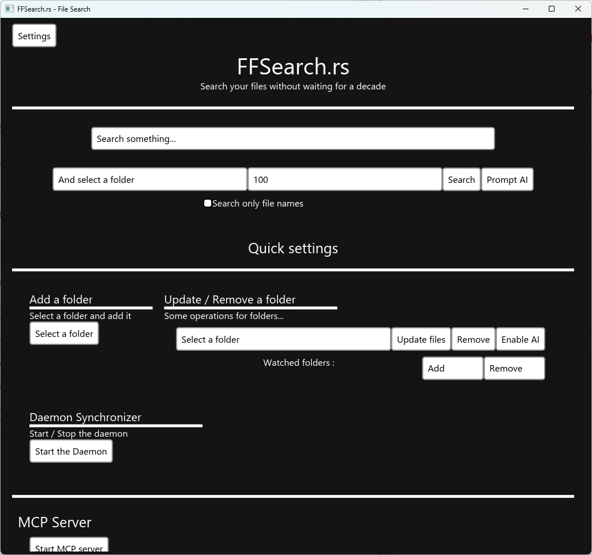
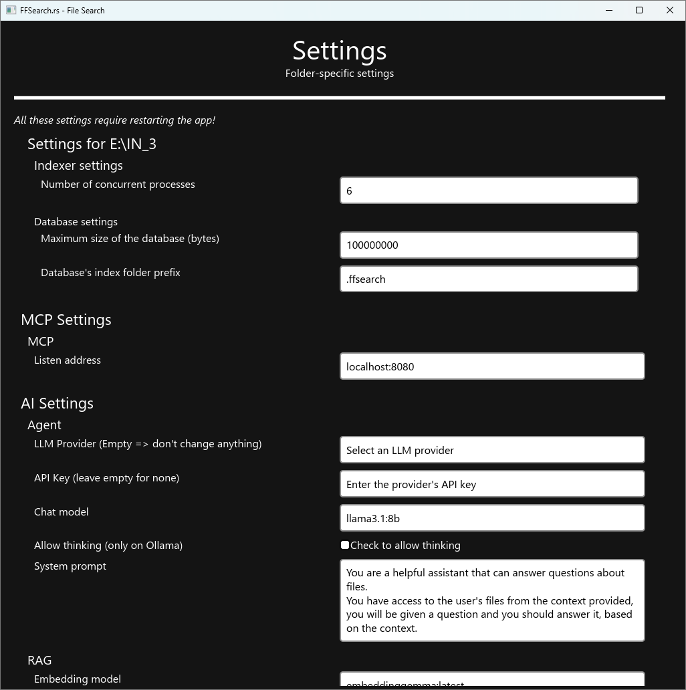
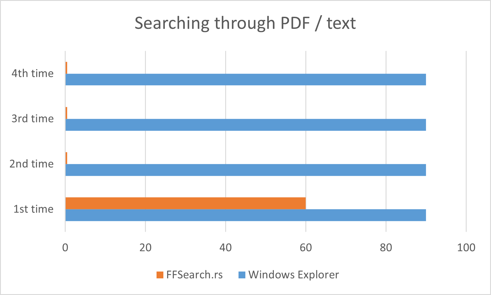

    

# Search your files without waiting for a decade

FFSearch is an program that helps you to find your files.
It works by using a database that stores the extracted content of your files.

It supports various file types, from pdf and docx to html and text

##### Note: this is a school project, but it's good enough to be used everyday

It also provides a lot of functionalities, such as:
- **MANDATORY** A cute Miku artwork as Logo
- Search filters
- Daemon to auto-save your modified files into the db
- **Optional, since it's AI usage** - Sorry it was a requirement of the project -
- **OPTIONAL** AI slop Agent
- **OPTIONAL** MCP Server

## Platforms
| System  | Support      |
|---------|--------------|
| Linux   | ✅           |
| Windows | ✅           |
| MacOS   | ❌ (Planned) |

<i>Linux & Windows platforms are only tested on amd64</i>

<i>Linux is only tested under Wayland</i>

## UI "preview"
### Lite (homepage)

### Full (homepage)

### Full (settings)

## Tutorial
FFSearch.rs works by creating a database of the content of your files inside a folder

This folder is named ".ffsearch"

This is done, so the program doesn't need to search through your files every time you search something

To synchronise the database with the real files, you select the folder you want to sync and click the "Update Files" button

## Daemon
When you download the "normal" or "full" version of the app, you have access to a "Daemon"

"Daemon" means a background process

You can click on "Start Daemon", "Add" a folder to it and it will sync files whenever they are saved / created

With that you don't need to "Update Files" everytime you change something

## AI
When you download the "full" version of the app, you have an AI assistant

You can configure it's provider (Ollama or OpenAI) in the Settings

Once configured, select a folder (that isn't too big) and click enable AI. This will create a RAG

Once the RAG created, you can click "Prompt AI" instead of "Search", this will open a chatbot window

## MCP
When you download the "full" version of the app, you have access to an MCP server

You can configure it's port and host in the settings

Then you can click on "Start MCP Server" and it will start the MCP server

You can now connect to it with a client

## Small benchmark
Take this with a grain of salt

That's a 300s gain in 4 searches!

## License
[MIT](./LICENSE)

## Language
- Rust

## FAQ
### Known issues
- On Windows, and on certain PCs, the app might show an error message the first time it opens
- Fix: Close the error message, and run the program a second time